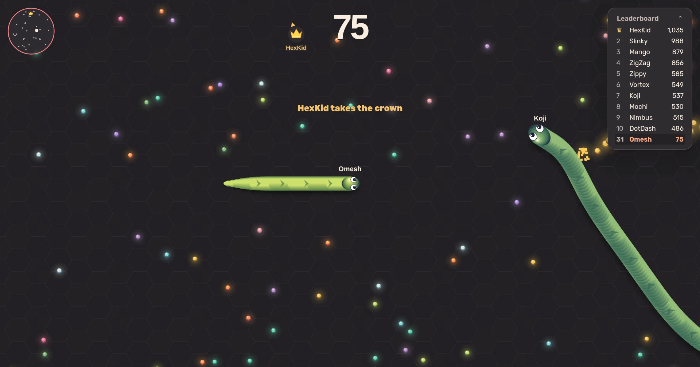
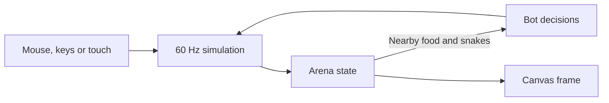

# pam.io

pam.io is a student-built snake arena where every rival is a bot running in your browser.
A spatial grid keeps collision checks local, and Canvas draws each frame from cached sprites.

[Play pam.io](https://pam-io.vercel.app) · [Quick start](#quick-start) · [Docs](#docs)


[](LICENSE)

[](https://pam-io.vercel.app)

## What you get

- **Five bot personalities.** Hunters cut across your path. Trappers circle. Scavengers rush the orbs left behind.
- **HD Canvas.** Snakes move smoothly between simulation ticks and render at up to 2× pixel density.
- **King Cobra.** Reach first place or score 1,500 to trigger the boss hunt. Hold the bolt circle to fire.
- **Twelve skins.** Score and kill milestones unlock skins. Your browser remembers your pick.
- **Landscape controls.** Steer with one thumb and boost with the other. Swap sides for left-handed play.

## How it works



Every tick, the game moves all snakes before it resolves hits.
Bots look up nearby food and rivals when it’s time to choose a direction.
Between ticks, Canvas draws the snakes partway between their last two positions.

## What's in this repo

```text
src/                  Game loop, input, menus, themes, and saved progress
  engine/             Movement, collisions, bot decisions, and difficulty
  render/             Arena, camera view, and cached sprites
  audio/              Sound effects generated with Web Audio
snake.io/             Snake.io design reference guides
  wireframes/         Screen layouts
  screenshots/        Reference images and their sources
```

## Quick start

From a clone of this repo, use Node.js LTS and npm.

```sh
npm ci
npm run dev
```

Open the URL Vite prints. Use the mouse or WASD to steer. Hold Space to boost.

To build and serve the production version, stop the dev server and run the commands below.

```sh
npm run build
npm run preview
```

Deploy `dist/` to any static host.

## Docs

- [Snake.io comparison and movement plan](docs/snake-io-comparison.md)

- [Player flow and orientation](snake.io/01-user-flow-and-orientation.md)
- [Home and skin shop](snake.io/02-home-and-skin-shop.md)
- [Gameplay HUD and HD rendering](snake.io/03-gameplay-hud-and-hd-visuals.md)
- [Game over and visual style](snake.io/04-gameover-popups-and-style.md)
- [Wireframes](snake.io/wireframes/) · [Screenshot sources](snake.io/screenshots/SCREENSHOT_MANIFEST.md)

## Status & License

Playable on desktop and mobile. The next milestone is open for suggestions in [Issues](https://github.com/omeshsidda-ui/pam.io/issues).
Original code uses the [MIT License](LICENSE). Fonts and reference art have [separate terms](THIRD_PARTY_NOTICES.md).
