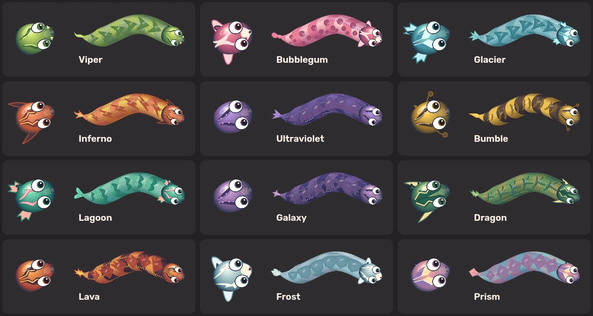

<h1 align="center">pam.io</h1>

<p align="center">
  A student-built snake arena that runs entirely in your browser.<br>
  Collect orbs, outmaneuver rival bots, and climb the leaderboard.
</p>

<p align="center">
  <strong><a href="https://pam-io.vercel.app">Play pam.io</a></strong> ·
  <a href="#controls">Controls</a> ·
  <a href="#run-locally">Run locally</a> ·
  <a href="#contributing">Contribute</a>
</p>

[](https://pam-io.vercel.app)

## Controls

| Action | Desktop | Mobile (landscape) |
| --- | --- | --- |
| Steer | Move the mouse or use **WASD** or the **arrow keys** | Drag the on-screen joystick |
| Boost | Hold **left mouse**, **Space**, or **Shift** | Hold the boost button |

On mobile, you can swap control sides in Settings.

## In the arena

- **Five bot personalities.** Hunters cut across your path, trappers circle, and scavengers rush for dropped orbs.
- **King Cobra.** Reach first place or score 1,500 to trigger the boss hunt. Find the bolt circle and hold it to fire.
- **Twelve skins.** Unlock skins through score and kill milestones. Your browser remembers your selection.



## Run locally

You’ll need Node.js LTS and npm.

```sh
git clone https://github.com/omeshsidda-ui/pam.io.git
cd pam.io
npm ci
npm run dev
```

Open the URL printed by Vite. To type-check the game and preview the production build, run:

```sh
npm run build
npm run preview
```

The build writes static files to `dist/`.

## How it works

TypeScript runs the simulation at 60 Hz. Each tick moves the snakes before resolving collisions, and a spatial grid keeps nearby food and rival lookups local. The Canvas 2D renderer interpolates between ticks and reuses cached sprites at up to 2× pixel density.

| Area | Where to look |
| --- | --- |
| Movement, collisions, bot AI, and difficulty | [`src/engine/`](src/engine/) |
| Canvas rendering and sprites | [`src/render/`](src/render/) |
| Input, timing, and round transitions | [`src/main.ts`](src/main.ts) |
| Settings and saved progress | [`src/storage.ts`](src/storage.ts) |
| Sound effects | [`src/audio/`](src/audio/) |

## Design docs

- [Movement and Snake.io comparison](docs/snake-io-comparison.md)
- [Bot AI research](docs/bot-ai-research.md) · [Bot hazard avoidance ADR](docs/adr/0001-bot-hazard-avoidance.md)
- [Player flow and orientation](snake.io/01-user-flow-and-orientation.md) · [Home and skin shop](snake.io/02-home-and-skin-shop.md)
- [Gameplay HUD and rendering](snake.io/03-gameplay-hud-and-hd-visuals.md) · [Game over and visual style](snake.io/04-gameover-popups-and-style.md)
- [Wireframes](snake.io/wireframes/) · [Screenshot sources](snake.io/screenshots/SCREENSHOT_MANIFEST.md)

## Contributing

Gameplay feedback and focused fixes are welcome. See [CONTRIBUTING.md](CONTRIBUTING.md) for how to reproduce a bug, verify a change, and open a PR. Share feedback in [GitHub Issues](https://github.com/omeshsidda-ui/pam.io/issues).

## License

The original code is [MIT licensed](LICENSE). See [third-party notices](THIRD_PARTY_NOTICES.md) for fonts and reference art.
