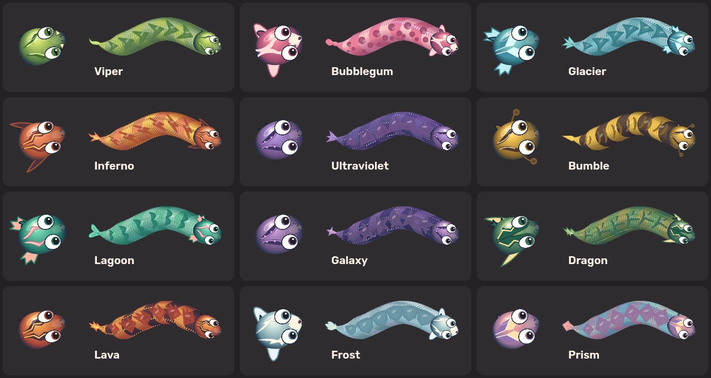

# Why Snake.io feels different

## Plan

1. **Make small corrections quicker.** Keep the existing turn radius for a full reversal and use the same movement rules for bots and the player.
2. **Make the camera consistent.** Base zoom and shake on elapsed time. Remove duplicate work from ordinary simulation ticks.
3. **Give each skin a recognizable shape.** Design the head, eyes, body bands, and markings together. Use the same original art in the shop and the arena.
4. **Give the opening a destination.** Put some of the existing food budget within a short glide of spawn while preserving offscreen bot spawns and room to maneuver.

## What the references show

The official browser page identifies a WebGL build. Its web control guide describes mouse or keyboard steering and hold-to-boost. pam.io already has those controls, a fixed 60 Hz simulation, and interpolated drawing. Matching an engine name or doubling the physics rate would tell us little about perceived responsiveness. [Kooapps web game](https://snake.io/) · [Browser controls](https://www.crazygames.com/game/snake-io)

In the live web tutorial, a purple snake follows the pointer across a pale hex field. Each rounded segment has its own shaded rim, so you can follow the bend even on a single-color skin. Our previous renderer painted an extra circle between each pair of overlapping segments, smoothing away that rhythm. We now shade the rim in the cached sprite and draw each body segment once.

The strongest visual difference is visible even in a still. Look at the pink head in the gameplay capture and the dragon in the event banner. The ears, snout, fins, and changes in body color make them recognizable before you see their names. Previously, pam.io used one head oval and four repeating marking shapes across twelve palettes. Those gameplay and event images are mobile/store references. The web-menu image is a separate browser reference. [Web menu](../snake.io/screenshots/01-web-main-menu.png) · [Gameplay capture](../snake.io/screenshots/06-gameplay-hd-snakes.webp) · [Event artwork](../snake.io/screenshots/08-live-event-skins-banner.webp) · [Image sources](../snake.io/screenshots/SCREENSHOT_MANIFEST.md)

## What changed in pam.io

| Area | What contributed to the difference | Change |
| --- | --- | --- |
| Steering | Input already set the target direction immediately. A small course correction and the start of a U-turn shared the same maximum turn rate. | Small corrections get up to 25% more turning speed. The assist tapers to zero at 60° of heading error. Broad turns still scale with snake size. |
| Camera | Zoom moved a fixed fraction **per frame**, so it settled faster on a 120 Hz screen. Random shake picked an unrelated offset each frame. | Zoom uses elapsed seconds. Shake follows a continuous, decaying motion. |
| Frame work | The world rebuilt the body grid before collision checks and again after an ordinary tick, even when the same bodies remained in the same positions. | Reuse the collision grid for the next bot decision. Refresh it on membership changes. Animated eyes use cached artwork. |
| Skins | Color carried much of the identity at gameplay size. | All twelve skins have individual markings. Bumble has dark bands and antennae, Dragon has swept horns and slit pupils, and Glacier has pale bands and side fins. Cosmetic details leave hitboxes alone. |
| Opening | Uniform random food could leave little to steer toward in the first second. | Use 21 of the initial 1,100 ambient pellets for three short trails ahead of the player, with another 99 scattered around the opening. Later food replenishment stays arena-wide. This is our pacing choice. |

Boost now draws two tapered strokes beside the active snake and plays a short rush of air on engagement. The touch button lights up while the snake is actually boosting. Body markings rotate with the interpolated curve, and nearby food moves between simulation positions as it is pulled in.

## What we could verify

- At starting mass, a 25° steering change reaches its target in four simulation ticks, down from five. That is one 60 Hz tick saved on this maneuver.
- After one simulated second, camera zoom closes about 88.2% of the initial gap at each of 60, 120, and 144 render updates per second.
- The shop and arena share the same cached face and marking artwork. Skin selection, saved unlocks, and equipped skin IDs survive the art change.

These are pam.io measurements. Screenshots and browser control descriptions cannot establish Kooapps’ turn curve, input-to-display delay, or sustained frame rate. A same-device recording of both games performing the same flick, reversal, and boost would be the next step for a numerical comparison.

[Movement](../src/engine/physics.ts) · [Camera](../src/engine/camera.ts) · [Skin artwork](../src/render/spriteCache.ts) · [Arena simulation](../src/engine/world.ts)

## Desktop frame pacing at 60 Hz

The old renderer resampled the full-screen hex floor every frame and drew the arena wall even when it was outside the view. The floor now moves on its own browser layer. The foreground skips the wall when it is offscreen, and the leaderboard updates existing rows.

In two before-and-after runs at 1920 × 1080 in headless Chromium, the slowest 5% of animation callbacks started at intervals of 50–67 ms or longer before the change. The 95th percentile fell to 16.7 ms in both updated runs. Of 675 intervals in the updated runs, one exceeded 25 ms. This measures browser callbacks during play. Physical display timing and Kooapps’ frame rate were not measured.

All twelve skins now have original face paint, distinct head silhouettes and textured bodies with full-width, rounded ends. The shop portrait enlarges the same face you see in the arena.
